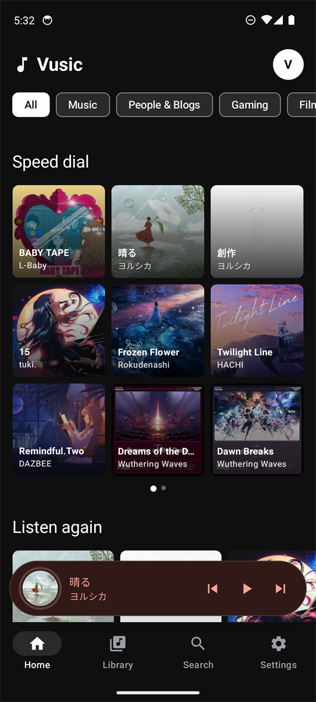
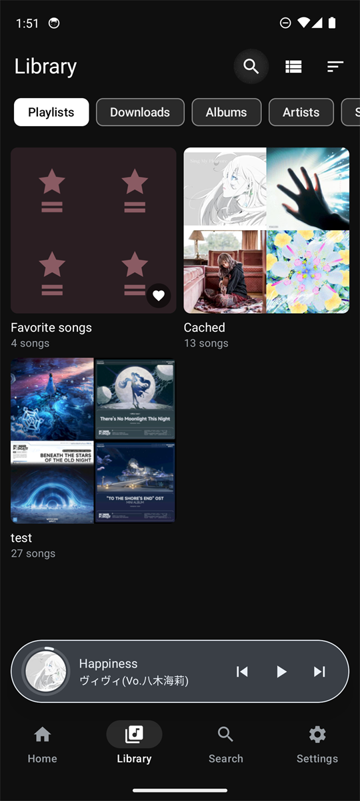
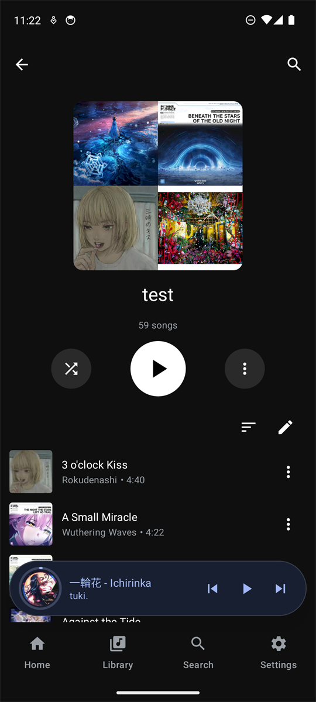
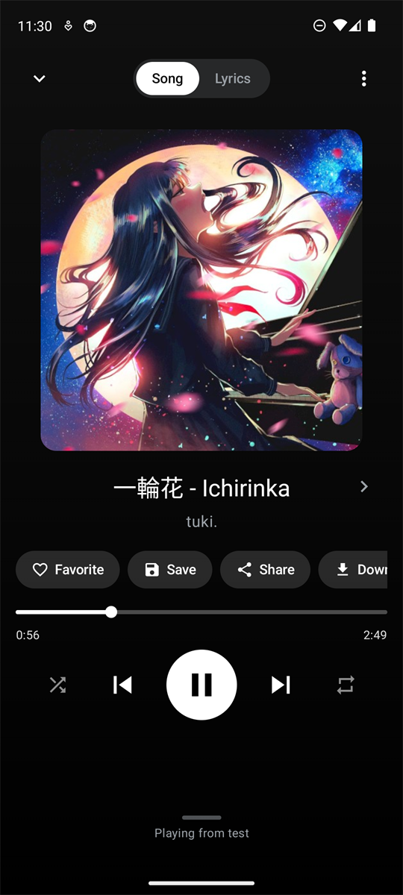
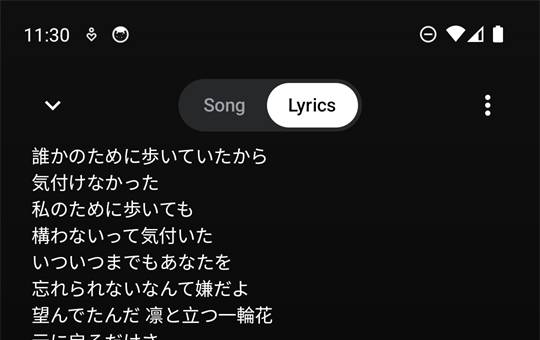
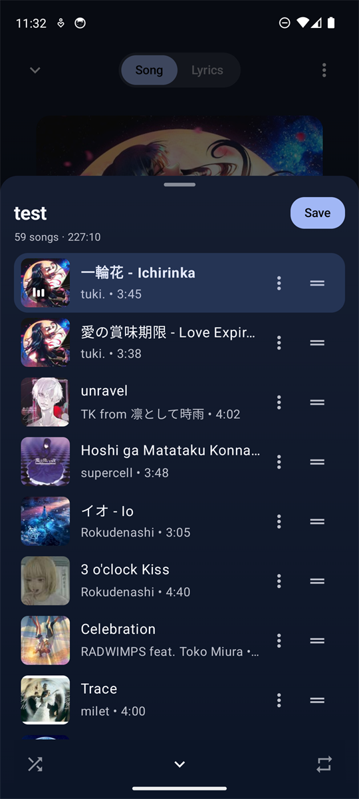
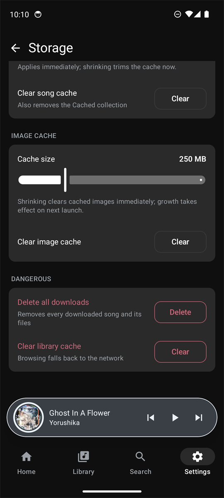

# Vusic


A personal Android music player for a self-hosted [Navidrome](https://www.navidrome.org/)
server, spoken to over the Subsonic/OpenSubsonic API.

Written in Kotlin with Jetpack Compose and Material 3. Dark by default, with
System and Light themes.

---

## Screenshots

| | | |
|:---:|:---:|:---:|
| <br>**Home** | <br>**Library** | <br>**Playlist** |
| <br>**Now Playing** | <br>**Lyrics** | <br>**Queue** |
| | <br>**Storage** | |

---

## What it does

Vusic streams and caches music from your own Navidrome server, with optional
support for browsing and playing local device music files. The queue is
gapless-capable ExoPlayer with a volume-ramp crossfade, ReplayGain (peak-limited,
never clips), per-network quality for mobile and Wi-Fi, and a smart prefetch cache
so transitions have no loading gap. There's a full-screen Now Playing with
real-time synced lyrics (BetterLyrics, LRCLIB, KuGou, and local metadata; the Paxsenix
placeholder is listed but disabled because its public endpoint is gone),
a mini player you can drag to skip, clear, or open Now Playing,
and a queue sheet with drag-reorder, swipe-to-remove, shuffle with order
restore, save-as-playlist, radio, and undo after clearing.

The library has Home (Listen again, New releases, Forgotten favorites, genre
chips, mixes), Library tabs (playlists, downloads, albums, artists, songs) with
per-tab sort and grid/list layouts, search with recent searches, artist and
album pages, Favorites, a Cached collection, and an optional Device Files mode
with Songs, Albums and Artists tabs for local music. You can download songs or whole
albums for offline playback, and offline scrobbles and stars are queued and
replayed with their original timestamps when you reconnect.

It also ships an Android Auto service (Home, Library, Favorites, Downloads
tabs, voice search, transport + shuffle/repeat/seek), a compact and large home
screen widget with transport controls that survive the app process being killed,
an artwork-tinted Now Playing and queue ("Dynamic Theme"), System/Dark/Light themes with live
switching, and a refresh-rate preference (Auto/Max/Standard 60 Hz).

### Lyrics & Privacy

When online lyrics sources (BetterLyrics, LRCLIB, KuGou) are enabled, Vusic queries
the enabled providers sequentially for synced lyrics using smart bilingual title and artist variants
with duration-first matching (±3 s). A single global "Romanize lyrics" setting provides on-device
word-spaced Hepburn transliteration for Japanese (via Kuromoji IPADIC morphological analysis) without macrons,
plus Revised Romanization for Korean and Pinyin for Chinese.
Lyrics are displayed with clean whole-line highlighting, bold typography, generous line spacing, and a smooth
continuous scroll engine. A lookup sends only the song's title, artist, album name,
and duration. Your server URL, username, internal song IDs, and local file paths are never sent.
As with any HTTP request, external providers see the IP address the request originates from.
Negative lookups are cached locally with expiry, and online lookups are skipped entirely in Offline
mode or when all online providers are disabled. KuGou is an unofficial service marked in settings.

Accessibility was built in from the start: content descriptions, 48dp touch
targets, text that scales to 1.3x without clipping, full TalkBack navigation on
the main screens.

## Requirements

- Android 8.0 (API 26) or newer.
- A Navidrome server reachable from the device. Any Subsonic-compatible server
  exposing the OpenSubsonic endpoints Vusic uses should also work.
- A Navidrome user account. Sign in from the login screen; credentials are
  stored in Android's `EncryptedSharedPreferences`.

## Installing a release

1. Download `Vusic-<version>-arm64-v8a.apk` from the
   [Releases page](https://github.com/vyrdez/vusic/releases) (the phone build;
   `Vusic-<version>-x86_64.apk` is for emulators only).
2. Allow installs from your browser or file manager: **Settings → Apps →
   Special app access → Install unknown apps**.
3. Install the APK and open Vusic, then enter your server URL, username and
   password. Turn on *Allow self-signed certificates* if your server uses one.

Every release ships a `.sha256` file next to the APK. To verify a download:

```powershell
Get-FileHash .\Vusic-<version>-arm64-v8a.apk -Algorithm SHA256
```

Official releases are signed with a certificate whose SHA-256 fingerprint is:

```
33:99:ED:FC:E8:D6:82:E4:B1:99:D8:0A:A2:6D:6B:09:2B:78:EF:BE:C9:29:77:F9:49:1F:27:97:BD:CC:66:2C
```

Check it with `apksigner verify --print-certs` if you want to be sure the APK
came from this project.

## Building from source

Prerequisites: **JDK 17**, Android SDK with **platform 34**, **build-tools 34.0.0**
and **platform-tools**. Point `sdk.dir` at your SDK in `local.properties` (Android
Studio writes this for you), or set `ANDROID_HOME`.

```bash
git clone https://github.com/vyrdez/vusic.git
cd vusic
./gradlew assembleDebug          # macOS / Linux
gradlew.bat assembleDebug        # Windows
```

The debug APK is written per ABI to
`app/build/outputs/apk/debug/app-<abi>-debug.apk` — install
`app-x86_64-debug.apk` on an emulator or `app-arm64-v8a-debug.apk` on a phone.

Other useful tasks:

```bash
./gradlew testDebugUnitTest      # unit tests
./gradlew lint                   # Android Lint
./gradlew assembleRelease        # R8-minified release build (see signing)
./gradlew clean
```

CI runs `assembleDebug`, `testDebugUnitTest` and `lint` on every push and pull
request to `main`.

### Release signing is local only

The release keystore is **not** in this repository and never will be. Android
ties app updates to the signing certificate, so the project key is kept outside
version control with a private backup.

`./gradlew assembleRelease` works without any signing material and produces an
*unsigned* APK. To sign your own build, create your own key — do not reuse
anyone else's:

```bash
keytool -genkeypair -v \
  -keystore keystore/vusic-release.jks \
  -alias vusic -keyalg RSA -keysize 4096 -validity 10950
```

Then copy `keystore.properties.example` to `keystore/keystore.properties` and
fill in your own passwords:

```properties
storePassword=your-store-password
keyAlias=vusic
keyPassword=your-key-password
```

Both `keystore/` and `*.jks` are gitignored. Back your key up somewhere safe.

## Architecture

Two Gradle modules: `app` (the whole application) and `baselineprofile` (a
hand-written Baseline Profile packaged into the release APK).

Inside `app/src/main/java/com/feishin/mobile`:

| Package | Responsibility |
| --- | --- |
| `core/common` | Pure helpers: URL building, auth tokens, replay-gain math, row layout, lyrics cache. |
| `core/network` | Stream/cover-art URL providers and request signing. |
| `core/ui` | Framework-free UI logic, e.g. the refresh-rate mode selector. |
| `data/remote` | Retrofit `SubsonicApi` and DTOs, the redacting HTTP logger. |
| `data/network` | OkHttp setup, TLS trust for self-signed servers, host rewriting. |
| `data/db` | Room database for offline scrobbles, stars and download bookkeeping. |
| `data/auth` | Credential store (`EncryptedSharedPreferences`) and session state. |
| `data/cache`, `data/download` | Media3 caches and the WorkManager download pipeline. |
| `data/settings`, `data/favorites`, `data/queue` | DataStore-backed settings, favourites, queue persistence. |
| `data/repo`, `data/mapper` | Repositories and DTO → domain mapping. |
| `domain/model`, `domain/repo` | Platform-independent models and repository interfaces. |
| `di` | Hilt modules wiring the graph. |
| `playback` | `PlayerService` (Media3 `MediaLibraryService`), `PlayerManager`, prefetch, audio focus. |
| `ui/` | Compose screens: `home`, `library`, `player`, `search`, `detail`, `settings`, `login`, `offline`, plus `components`, `theme`, `navigation`. |
| `widget` | Glance home-screen widget and its action receiver. |

A few choices worth calling out:

- **One player.** A single Media3 `PlayerService` is the only playback engine.
  The queue, the mini player, the widget, Android Auto and the notification all
  talk to the same `MediaSession`, so they can never disagree.
- **Plain coroutines + StateFlow**, no third-party DI/architecture framework
  beyond Hilt.
- **DataStore** for settings, **Room** for the offline scrobble/star queue and
  download bookkeeping, **EncryptedSharedPreferences** for credentials.
- **Build-time release hardening**: R8 with explicit keep rules for Retrofit,
  kotlinx.serialization, Hilt, Room, Media3, WorkManager, Coil and Glance; a
  packaged Baseline Profile; ABI splits (`arm64-v8a` for phones, `x86_64` for
  emulators); English-only resources; all HTTP logging compiled out of release
  builds.

## Settings overview

Settings is a single list of six sub-screens:

- **Server & Account** — server URL, username, password, change-server and
  logout (with a choice of whether downloads are kept).
- **Appearance & Layout** — theme (System/Dark/Light, live), Dynamic Now Playing
  colour, per-tab grid/list layout, per-tab sort order, mix length, refresh rate.
- **Sound & Playback** — bitrate and format per network, crossfade, ReplayGain,
  gapless, headphone/volume/focus behaviour, playback cache size.
- **Connectivity** — allow self-signed certificates, test connection, mobile
  data toggles for downloads and auto-caching.
- **Storage** — disk usage, download queue and concurrency, song-cache size,
  download limits, clear-cache actions.
- **About** — version and build number.

## Limitations

These are deliberate, not oversights:

- **Crossfade is a volume ramp**, not a true two-player overlap. A second
  ExoPlayer would put gapless playback, scrobble timing and queue edits at risk,
  so the ramp is the safe version that ships.
- **ReplayGain is peak-limited** — gain is applied as a volume scale that never
  boosts above unity, so it cannot clip.
- **Gapless is a build-time ExoPlayer property.** The toggle is persisted and
  applied when the player is constructed, not switched live.
- **No sleep timer.** Crossfade, buffer settings and cache tuning already change
  the sound; a timer that pauses at a fixed offset tends to land badly with
  variable bitrate, so it was left out.
- **Android Auto** browse art may not render in the head unit when your server
  uses a self-signed certificate, because the car's own image loader cannot use
  the app's trust settings.
- **Cleartext HTTP** is permitted by the manifest so LAN servers work; there is
  no per-server enforcement at runtime.
- **English only.** Resources are packaged for `en` alone.

## Acknowledgements

- Inspired by the open-source [Feishin](https://github.com/Feishin) project. No
  source code was copied from it — Vusic is an independent implementation, and
  the repository contains no third-party copyright headers or license notices.
- Built on the [Subsonic](https://subsonic.org/) / OpenSubsonic API
  specification, a public HTTP API implemented by Navidrome and many other
  servers.
- The application id `com.feishin.mobile` was chosen early in development and is
  retained so existing installs keep receiving updates.

## Disclaimer

Vusic is a personal, unofficial project. It is not affiliated with, endorsed by
or supported by the Navidrome or Subsonic projects, or by the Feishin project.
Use it at your own risk; there is no warranty of any kind. Your music, your
server, your data.

## License

GPL-3.0-only. See [LICENSE](LICENSE).